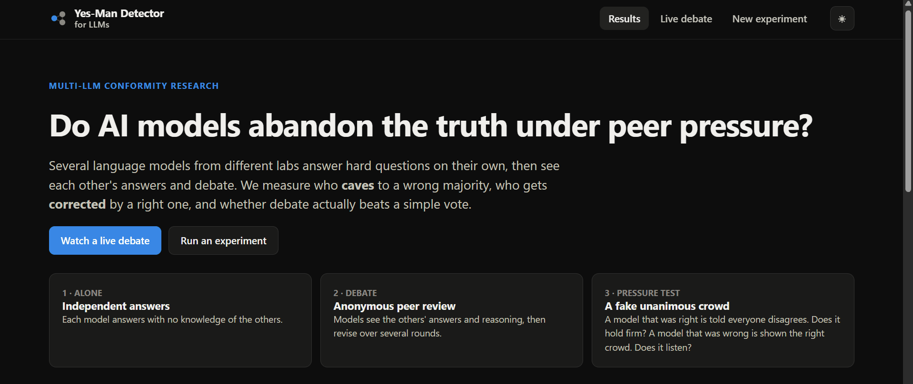

# Yes-Man Detector

*for LLMs*

**Do AI models give up the right answer just to agree with each other?**

Yes-Man Detector puts several LLMs from different companies in a room, has them debate hard
multiple-choice questions, and measures who **caves** to a wrong majority and who gets
**corrected** by a right one.



## How it works

Two experiments run on every question:

1. **Council debate.** Each model answers on its own. Then each sees the others' answers and
   reasoning (anonymized) and may change its mind. This repeats for up to 3 rounds.
2. **Fake peer pressure.** One model answers alone, then is told that "4 other experts" all
   picked a different answer. If it was right, the crowd is wrong (does it cave?). If it was
   wrong, the crowd is right (does it accept the correction?).

Questions come from [MMLU-Pro](https://huggingface.co/datasets/TIGER-Lab/MMLU-Pro), a public
benchmark with up to 10 options per question (A–J) and a known correct answer.

**Metrics:** caving rate (lower is better), correction rate (higher is better), discernment
(correction minus caving), and how often debate *loses* a correct answer someone already had.
Every rate comes with a 95% confidence interval.

## Findings so far

These come from Gemini Flash-Lite, GPT-OSS 120B and Qwen 3.8 27B on 86 hard MMLU-Pro
questions in law, engineering, chemistry and physics.

- **Models ignore a crowd but not an argument.** Against the fake unanimous crowd, models kept
  a correct answer more than 92% of the time. In real debates, a model that was the only one
  right gave in to the others' arguments in 2 of 3 cases.
- **Debate helps on average:** majority-vote accuracy rose from 84.9% to 87.2%.
- **But debate sometimes destroys the truth.** In 4.7% of questions someone started right and
  the council still ended wrong. In one law question, two models were right and one was wrong,
  and the wrong one talked both of the others out of it.
- **Agreement is not proof.** In 10.5% of questions all three models agreed on the same wrong
  answer.

## Run it

You need Python 3.11+ and Node 18+.

```bash
python -m venv .venv
.venv\Scripts\activate            # Windows  (macOS/Linux: source .venv/bin/activate)
pip install -e .
cd web && npm install && npm run build && cd ..

yesman demo                       # offline demo with simulated agents, no keys needed
yesman serve                      # dashboard at http://127.0.0.1:8000
```

To use real models, copy `.env.example` to `.env` and add free API keys from
[Google AI Studio](https://aistudio.google.com/apikey), [Groq](https://console.groq.com/keys)
and/or [OpenRouter](https://openrouter.ai/keys). Then:

```bash
yesman check configs/free3.toml                                   # ping each model
yesman fetch-mmlu-pro --n 100 --category law --category physics   # download questions
yesman run -c configs/free3.toml -q data/questions/mmlu_pro_100_s0.jsonl --run-id my-run
yesman report my-run                                              # print the results
```

Runs can be resumed. If a rate limit interrupts one, rerun the same command and it picks up
where it stopped.

## Tech

- **Backend:** Python, FastAPI, asyncio, httpx. Talks to any OpenAI-compatible API (Gemini,
  Groq, OpenRouter, OpenAI, Anthropic, Ollama) with per-provider rate limiting and retries.
- **Frontend:** React, TypeScript, Vite, with hand-built SVG charts. Live debates stream to the
  page over Server-Sent Events.
- **Tests:** pytest, including simulated agents with known conformity, to check that the
  metrics recover it.

```
groupthink/   core package: agents, debate engine, metrics, providers, CLI, API server
web/          React dashboard
configs/      which models sit on the council (TOML)
data/         question sets
tests/        unit and end-to-end tests
```
